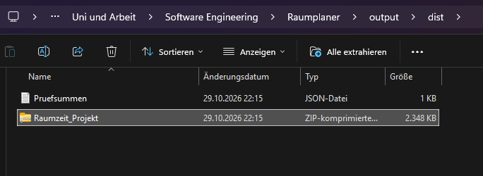
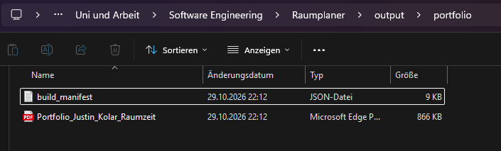

# SE Prompt Chat – Originaldialog

Exportiert: 2026-11-05T13:49:17.899326+00:00
Chat-ID: `01a188e7-7083-7561-8b5e-12f0fb403488`

Ungekürzte gespeicherte Nutzernachrichten und sichtbare Assistentenantworten abgeschlossener Gesprächsturns. Fragebogenfragen und tatsächliche Antworten sind enthalten. Der Export ist keine Zusammenfassung. Technische Werkzeugprotokolle, interne Denkprotokolle, Systemanweisungen und noch laufende Gesprächsturns sind nicht enthalten. Bilder werden als gesonderte Anlagen mitgeliefert. Weitere Details und Prüfsummen stehen in README.md und export_manifest.json.

---

## 001 · Justin Kolar · 2026-10-29T18:24:59.185Z

guck dir bitte das projekt als dozent an und bewerte das
sag mir außerdem was man verbessern sollte/könnte


---

## 002 · KI-Assistent · 2026-10-29T18:25:01.939Z

Ich schaue mir Aufbau, Code, Tests und Dokumentation an und bewerte das Projekt aus Dozentensicht. Daraus leite ich eine vorläufige Note und konkrete Verbesserungen nach Priorität ab.


---

## 003 · KI-Assistent · 2026-10-29T18:25:17.456Z

Ich habe das Projekt „Raumzeit“ gefunden. Es enthält bereits Tests und ein umfangreiches Portfolio. Ich nutze zusätzlich die PDF-Skill, um die Bewertung mit den tatsächlichen Abgabevorgaben abzugleichen und die Dokumentation zu prüfen.


---

## 004 · KI-Assistent · 2026-10-29T18:25:54.993Z

Die technische Struktur wirkt bisher solide: Fachregeln, HTTP und Datenbank sind getrennt; die Tests prüfen auch Doppelbuchungen und veraltete Änderungen. Ein wesentlicher Punkt für die Benotung ist aber noch offen: Die Unterlagen bezeichnen sich ausdrücklich als KI-erstellte Arbeitsfassung, und deine persönliche Prüfung und Reflexion sind noch nicht dokumentiert.


---

## 005 · KI-Assistent · 2026-10-29T18:26:53.461Z

Die vorhandenen 88 Tests bestehen auch bei meiner erneuten Ausführung. Ich prüfe jetzt noch die Grenzen dieser Tests, die Bedienlogik und die Argumentation im Portfolio. Die hohe Python-Abdeckung allein reicht für eine gute Gesamtnote noch nicht aus.


---

## 006 · KI-Assistent · 2026-10-29T18:28:13.091Z

Meine zusätzlichen Gegenproben haben zwei Schwachstellen gezeigt: Ein ungültiges CSRF-Token mit Umlaut löst einen internen Fehler aus. Außerdem kann ein veralteter Raumdialog eine neuere Änderung überschreiben; der Versionsschutz gilt bisher nur für Buchungen. Beide Fälle fehlen in der bestehenden Testsuite.


---

## 007 · KI-Assistent · 2026-10-29T18:29:49.283Z

**Meine vorläufige Bewertung: etwa 2,3 – gut.** Die technische Umsetzung würde ich eher bei **1,7–2,0** sehen. Für eine überzeugende Einzelportfolio-Abgabe fehlen vor allem die dokumentierte persönliche Prüfung und deine eigene Reflexion.

Das gilt unter der Annahme, dass KI-Unterstützung im offengelegten Umfang erlaubt ist. Grundlage ist die [im Projekt dokumentierte Bewertungsmatrix](</D:/Uni und Arbeit/Software Engineering/Raumplaner/docs/auftrag.md>); die ursprünglichen Prüfungsunterlagen liegen mir nicht vollständig vor.

Ich habe Code, Anforderungen, Dokumentation und Screenshots geprüft sowie die Tests erneut ausgeführt: **88 von 88 bestanden.** Zusätzlich habe ich eigene Gegenproben durchgeführt.

| Bewertungsbereich | Einschätzung aus Dozentensicht |
|---|---|
| Projektmanagement · 20 % | Zeitplan, Risiken und Meilensteine sind vorhanden. Dein eigener Prüfungs- und Entscheidungsprozess ist noch zu wenig nachgewiesen. |
| Inhalt · 50 % | Klare Fachregeln, passende Architektur und aussagekräftige Tests. Einzelne Robustheitslücken bleiben. |
| Struktur und Argumentation · 20 % | Nachvollziehbarer Weg von Anforderungen über Architektur zur Verifikation. Teilweise wiederholen sich Hinweise auf Grenzen und KI-Unterstützung. |
| Formales · 10 % | Ordentliche Gestaltung, Quellen, beschriftete Abbildungen und angemessener Umfang. Der Arbeitsfassungsstatus muss vor der Abgabe geklärt werden. |

Das Portfolio umfasst 26 Seiten, davon zwölf Seiten Haupttext, und wirkt insgesamt sauber aufgebaut: :codex-file-citation{path="D:\Uni und Arbeit\Software Engineering\Raumplaner\output\portfolio\Portfolio_Justin_Kolar_Raumzeit.pdf" purpose="source"}

**Was besonders gut gelungen ist**

- **Die Architektur ist tatsächlich umgesetzt:** Fachlogik, HTTP und Datenbank sind getrennt. Der SOLID-Bezug ist am Code nachvollziehbar.
- **Die Tests behandeln relevante Fehlerfälle:** Überschneidungen, angrenzende Termine, Rollback, veraltete Buchungsstände und konkurrierende Zugriffe.
- **Die Transaktionsentscheidung ist fachlich passend:** Konfliktprüfung und Speicherung erfolgen gemeinsam. Das berücksichtigt das dokumentierte [SQLite-Verhalten bei Schreibtransaktionen](https://www.sqlite.org/lang_transaction.html).
- **Der Umfang ist sinnvoll begrenzt:** Für dieses lokale Studienprojekt würde ich fehlende Anmeldung, Cloudfunktionen oder Serienbuchungen nicht pauschal abwerten.

**Was du zuerst verbessern solltest**

1. **Persönliche Prüfung und Reflexion abschließen.**  
   Die [Prüfliste](</D:/Uni und Arbeit/Software Engineering/Raumplaner/docs/eigene_pruefung.md>) ist vollständig offen. Als Dozent würde ich wissen wollen: Was hast du selbst geprüft, welche Schwäche entdeckt und welche Entscheidung kannst du begründen? Dokumentiere tatsächliche Beobachtungen und Schlussfolgerungen. Das ist derzeit der größte Hebel für die Bewertung.

2. **Zwei konkret nachgewiesene technische Schwachstellen beheben.**
   - In der [CSRF-Prüfung](</D:/Uni und Arbeit/Software Engineering/Raumplaner/raumzeit/web.py:43>) verursacht ein ungültiges Token wie `ä` einen **HTTP-500-Fehler**. Erwartbar wäre eine kontrollierte Ablehnung mit 403. Dafür fehlt ein Regressionstest.
   - Beim [Speichern von Räumen](</D:/Uni und Arbeit/Software Engineering/Raumplaner/raumzeit/application.py:18>) fehlt der Versionsschutz. Meine Gegenprobe: Eine Standortänderung auf „1. OG“ wurde durch das spätere Speichern eines älteren Raumstands wieder auf „EG“ zurückgesetzt. Zwei geöffnete Dialoge reichen dafür aus.

3. **Frontendprüfungen wiederholbar machen.**  
   Die dokumentierten Browserbeobachtungen sind hilfreich. Ergänzend wären wenige automatisierte Abläufe sinnvoll: Buchung anlegen, Konflikt anzeigen, bearbeiten und stornieren. Die ausgewiesenen rund 99 % Abdeckung betreffen Python; daraus folgt keine entsprechende Absicherung des JavaScripts.

4. **Die wissenschaftliche Argumentation konkreter machen.**  
   Kritische Quellenarbeit ist bereits vorhanden. Stärker wäre ein durchgängiges Beispiel: Anforderung → Entscheidung → Test → Ergebnis → verbleibende Grenze. Die beiden gefundenen Schwachstellen eignen sich nach eigener Prüfung gut für eine ehrliche Reflexion.

**Was zusätzlich sinnvoll wäre**

- JavaScript, HTML und besonders das stark verdichtete CSS lesbarer formatieren.
- ReportLab und Pillow als festgelegte Dokumentationsabhängigkeiten aufnehmen; beide fehlen in der Projektumgebung.
- Den tatsächlichen Abschlussstand mit Datum, eigenen Prüfergebnissen und nachvollziehbaren Änderungen dokumentieren.

Für das Kolloquium würde ich besonders prüfen, ob du **die Überschneidungsbedingung, die gemeinsame Schreibtransaktion und den Unterschied zwischen hoher Testabdeckung und fachlicher Korrektheit** selbst erklären kannst. Davon würde meine endgültige Bewertung wesentlich abhängen.

---

## 008 · Justin Kolar · 2026-10-29T18:31:30.018Z

schreib mir bitte den prompt für den mainchat


---

## 009 · KI-Assistent · 2026-10-29T18:32:09.798Z

Kopiere diesen Prompt in den Mainchat:

```text
Bitte überarbeite das Projekt „Raumzeit“ unter
D:\Uni und Arbeit\Software Engineering\Raumplaner
anhand der folgenden unabhängigen Bewertung aus Dozentensicht.

Die Einschätzung war: technisch etwa 1,7–2,0, als derzeitige Einzelportfolio-Arbeitsfassung etwa 2,3. Die vorhandenen 88 Tests bestanden. Hauptverbesserungspunkte sind zwei nachgewiesene Fehler, die Absicherung des Frontends sowie die persönliche Prüfung und Reflexion.

Bitte prüfe die Befunde zunächst selbst und setze die technischen und dokumentarischen Verbesserungen anschließend um:

1. CSRF-Fehler beheben:
Ein ungültiges X-CSRF-Token mit Nicht-ASCII-Zeichen, beispielsweise „ä“, verursacht bei secrets.compare_digest einen TypeError und HTTP 500. Solche Eingaben müssen kontrolliert mit HTTP 403 abgelehnt werden. Ergänze einen Regressionstest; gültige Token müssen weiterhin funktionieren.

2. Verlorene Raumänderungen verhindern:
Buchungen besitzen bereits einen Versionsschutz, Räume bisher nicht. Ein älterer Raumdialog kann neuere Änderungen überschreiben. Ergänze einen entsprechenden Schutz durch Datenhaltung, Service, API und Oberfläche. Bestehende Datenbanken müssen weiter verwendbar bleiben. Teste insbesondere, dass eine veraltete Änderung mit 409 abgewiesen wird und der aktuelle Datensatz erhalten bleibt.

3. Frontend verlässlich prüfen:
Ergänze wenige wiederholbare Browsertests für Buchung anlegen, Überschneidung ablehnen, Buchung bearbeiten und stornieren. Prüfe außerdem mobile Bedienung und kurze 15-Minuten-Termine. Trenne Python-Abdeckung und Browsernachweise weiterhin klar.

4. Wartbarkeit und Reproduzierbarkeit verbessern:
Formatiere das stark verdichtete HTML, CSS und JavaScript lesbar, ohne unnötigen Architekturumbau. Dokumentiere und fixiere die zusätzlichen Abhängigkeiten für die Portfolioerstellung, insbesondere ReportLab und Pillow.

5. Portfolio gezielt schärfen:
Verknüpfe Anforderungen, Entscheidungen, Tests und Ergebnisse anhand konkreter Beispiele. Kürze Wiederholungen und aktualisiere die tatsächlich ausgeführten Prüfungen und bekannten Grenzen. Berücksichtige die dokumentierte Bewertungsmatrix mit 20 % Projektmanagement, 50 % Inhalt, 20 % Struktur/Argumentation und 10 % Formales.

Wichtig: Erfinde keine persönlichen Tätigkeiten, Lernerfahrungen, Betreuerkommunikation oder Eigenständigkeitsnachweise von mir. Kennzeichne deine Prüfungen als KI-gestützt. Bereite die persönliche Prüfung vor und leite mich anschließend durch konkrete Aufgaben und Reflexionsfragen. Trage persönliche Ergebnisse erst nach meiner tatsächlichen Durchführung und Rückmeldung ein.

Halte den bestehenden lokalen Funktionsumfang ein. Neue Cloud-, Login- oder Serienfunktionen sind nicht erforderlich.

Führe die relevanten Prüfungen aus, aktualisiere anschließend Portfolio, Testnachweise und Abgabearchiv konsistent und prüfe das PDF visuell. Berichte abschließend knapp, was verbessert wurde, welche Prüfungen bestanden haben und welche persönlichen Schritte vor der Abgabe noch offen sind.
```

---

## 010 · Justin Kolar · 2026-10-29T19:22:50.544Z

guck bitte wieder drüber danke (:


---

## 011 · KI-Assistent · 2026-10-29T19:22:56.883Z

Ich prüfe den aktuellen Stand erneut – besonders die beiden Fehler, die neuen Tests und die Änderungen am Portfolio. Danach sage ich dir, was sich verbessert hat und was vor der Abgabe noch offen ist.


---

## 012 · KI-Assistent · 2026-10-29T19:23:22.243Z

Die beiden gemeldeten Fehler sind im Code gezielt adressiert. Neu hinzugekommen sind außerdem Raumversionen mit Datenbankmigration und wiederholbare Browsertests. Ich prüfe jetzt, ob diese Nachweise zum aktuellen Quellstand passen, und führe die Tests erneut aus. Für die Browserprüfung nutze ich die Playwright-Skill.


---

## 013 · KI-Assistent · 2026-10-29T19:24:44.646Z

Die 118 Python-Tests bestehen bei meiner Wiederholung. Auch die Formatprüfung ist erfolgreich; Testmanifeste, PDF-Prüfsumme und Abgabearchiv passen zum aktuellen Stand.

In der persönlichen Prüfanleitung habe ich einen Widerspruch gefunden: Nach P2 bleibt ein erlaubter Anschlusstermin bestehen. Deshalb ist die Erwartung „kein aktiver Termin“ nach P3 zu pauschal formuliert.


---

## 014 · KI-Assistent · 2026-10-29T19:25:11.596Z

Die erneute Browserprüfung scheitert bisher an der Sandbox: Sie blockiert lokale Netzwerkverbindungen zum Testserver. Ich versuche den Lauf mit der nötigen Freigabe außerhalb der Sandbox. Die bisherigen 12 erfolgreichen Browserausführungen sind durch Berichte und ein passendes Quellmanifest belegt.


---

## 015 · KI-Assistent · 2026-10-29T19:27:00.784Z

Alle 12 Browserausführungen bestehen auch bei meinem erneuten Lauf. Eine zusätzliche Einzelprüfung zeigt aber eine Schwäche im Testaufbau: E06 scheitert allein auf einer frischen Datenbank, weil er Buchungen aus vorherigen Tests voraussetzt. Das ist ein Testproblem; einen neuen Anwendungsfehler habe ich damit nicht nachgewiesen.


---

## 016 · KI-Assistent · 2026-10-29T19:27:37.107Z

Ja – **der Stand ist deutlich besser. Meine vorläufige Einschätzung liegt jetzt bei etwa 2,0, technisch eher bei 1,7.** Die endgültige Bewertung hängt weiterhin von deiner persönlichen Prüfung, dem Kolloquium und den geltenden KI-Regeln ab.

Ich habe erneut selbst geprüft:

- **118 Python-Tests bestanden.**
- **12 Browserausführungen bestanden**, einschließlich Desktop und Mobilansicht.
- Beide ursprünglichen Fehler sind behoben: Ungültige Unicode-CSRF-Token liefern 403; veraltete Raumänderungen werden abgewiesen und erhalten den aktuellen Stand.
- Die Formatprüfung besteht. Testmanifeste, PDF-Prüfsumme und Dateien im Abgabearchiv stimmen mit dem aktuellen Projektstand überein.

Das Portfolio argumentiert inzwischen konkreter mit Anforderungen, Entscheidungen und tatsächlichen Fehlerbefunden. Auch die Trennung zwischen Python-Abdeckung und Browserprüfung ist sauberer: :codex-file-citation{path="D:\Uni und Arbeit\Software Engineering\Raumplaner\output\portfolio\Portfolio_Justin_Kolar_Raumzeit.pdf" purpose="source"}

**Drei konkrete Punkte würde ich noch korrigieren:**

1. **Browserfall E06 muss eigenständig funktionieren.**  
   Die komplette Suite besteht, aber E06 scheitert einzeln auf einer frischen Datenbank: Er erwartet mehrere Buchungen, erzeugt selbst jedoch nur eine. Ich habe das reproduziert. Der Test sollte seine benötigten Vergleichsräume und Buchungen selbst anlegen. Siehe [betroffene Assertion](</D:/Uni und Arbeit/Software Engineering/Raumplaner/browser_tests/raumzeit.spec.js:220>).

2. **Die persönliche Prüfanleitung enthält einen falschen Sollzustand.**  
   P2 legt einen erlaubten Anschlusstermin von 10:15–10:30 an. Dieser bleibt nach P3 aktiv. Die Aussage „Kein aktiver Termin“ ist deshalb missverständlich. Richtig wäre: „Der stornierte Termin ist nicht mehr aktiv; der Anschlusstermin bleibt bestehen.“ Siehe [P3](</D:/Uni und Arbeit/Software Engineering/Raumplaner/docs/eigene_pruefung.md:19>).

3. **Die Anzahl der Architekturentscheidungen ist veraltet.**  
   Im Portfolio steht weiterhin „vier Architecture Decision Records“, inzwischen sind es sechs. Das ist eine kleine redaktionelle Korrektur in der [Textquelle](</D:/Uni und Arbeit/Software Engineering/Raumplaner/docs/portfolio_inhalt.json:363>).

**Der wichtigste offene Punkt bleibt deine eigene Prüfung und Reflexion.** Die [persönlichen Ergebnisse](</D:/Uni und Arbeit/Software Engineering/Raumplaner/docs/persoenliche_ergebnisse.json>) stehen weiterhin auf „offen“. Aus Dozentensicht zählen jetzt besonders nachvollziehbare eigene Beobachtungen und deine Erklärung, warum Transaktion und Versionsnummer unterschiedliche Probleme lösen. Das würde die Abgabe stärker verbessern als zusätzliche Funktionen.

---

## 017 · Justin Kolar · 2026-10-29T19:29:04.938Z

okay erstmal eine frage und dann gib mir bitte wieder den nächsten prompt
frage: kann ich das projekt mit der doku einfach so abgeben oder muss ich da noch was machen?


---

## 018 · KI-Assistent · 2026-10-29T19:29:44.124Z

**Fast – ich würde es noch nicht unverändert abgeben.** Anwendung und Dokumentation sind technisch gut vorbereitet. Es fehlen aber noch:

- **Drei kleine Korrekturen:** E06 als unabhängiger Test, der Sollzustand bei P3 und „sechs statt vier Architekturentscheidungen“.
- **Deine tatsächliche persönliche Prüfung und Reflexion.** Die Dokumentation bezeichnet diese ausdrücklich als offen. Du solltest die Anwendung selbst bedienen und die wesentlichen Entscheidungen erklären können.
- **Der abschließende Abgleich mit den Abgabevorgaben:** geforderte persönliche Angaben, KI-Dokumentation, gegebenenfalls Eigenständigkeitserklärung und einzureichende Dateien.

Danach müssen PDF und Archiv noch einmal konsistent erzeugt werden. Den Hinweis „Arbeitsfassung“ sollte man erst nach deiner tatsächlichen Prüfung und Freigabe entsprechend aktualisieren. Weitere Funktionen brauchst du dafür aus meiner Sicht nicht.

Diesen Prompt kannst du in den Mainchat kopieren:

```text
Bitte bringe Raumzeit jetzt gezielt zur abgabefertigen Fassung. Projekt:
D:\Uni und Arbeit\Software Engineering\Raumplaner

Die erneute Prüfung ergab: 118 Python-Tests und alle 12 Browserausführungen bestehen. Die beiden ursprünglichen Anwendungsfehler sind behoben. Es bleiben folgende Aufgaben:

1. Browserfall E06 unabhängig machen:
Einzeln auf einer frischen Datenbank scheitert der Desktop-Test an der Erwartung „mehr als eine Buchung“. Er verwendet Daten vorheriger Tests. Lege die benötigten Vergleichsräume und Buchungen innerhalb seines eigenen Setups an. Prüfe E06 anschließend einzeln und danach die komplette Browsersuite.

2. Persönliche Prüfanleitung korrigieren:
P2 erzeugt einen erlaubten Anschlusstermin von 10:15–10:30. Nach Stornierung des ersten Termins in P3 bleibt dieser Anschlusstermin aktiv. Korrigiere den pauschalen Sollzustand „Kein aktiver Termin“ in Anleitung und Portfolio entsprechend.

3. Redaktionelle Konsistenz:
Im Portfolio steht noch „vier Architecture Decision Records“, obwohl inzwischen sechs vorhanden sind. Korrigiere die Textquelle und prüfe vergleichbare veraltete Angaben.

4. Meine persönliche Prüfung durchführen:
Leite mich anschließend schrittweise durch P1–P6. Gib mir konkrete Bedienaufgaben und Verständnisfragen und warte auf meine tatsächlichen Beobachtungen und Antworten. Erfinde keine persönlichen Ergebnisse, Tätigkeiten oder Lernerfahrungen. Trenne deine automatisierten Prüfungen weiterhin von meinen eigenen Kontrollen.

Unterstütze mich danach dabei, aus meinen tatsächlichen Antworten eine eigene, konkrete Reflexion zu formulieren. Markiere Prüfung und fachliche Freigabe erst nach meiner entsprechenden Rückmeldung als abgeschlossen.

5. Abgabe abschließen:
Gleiche die verfügbaren Abgabevorgaben mit den vorhandenen Unterlagen ab. Benenne fehlende Informationen, die daraus nicht hervorgehen, ohne Anforderungen zu erfinden.

Nach den Korrekturen und meiner persönlichen Freigabe: relevante Prüfungen ausführen, PDF neu erzeugen und visuell kontrollieren, Arbeitsfassungsstatus zutreffend aktualisieren und das Abgabearchiv mit konsistenten Nachweisen neu erstellen.

Nenne mir abschließend die konkreten Abgabedateien und verbleibenden manuellen Schritte. Keine zusätzlichen Funktionen ergänzen und nichts selbst einreichen oder versenden.
```

---

## 019 · Justin Kolar · 2026-10-29T20:53:12.759Z

okay was ist jetzt der nächste schritt?
weil ich würde dann gerne jetzt gleich abgeben


---

## 020 · KI-Assistent · 2026-10-29T20:53:22.903Z

Ich prüfe kurz, ob die letzten Korrekturen und deine persönliche Prüfung inzwischen abgeschlossen sind. Dann nenne ich dir den nächsten Schritt für die Abgabe.


---

## 021 · KI-Assistent · 2026-10-29T20:54:14.503Z

**Jetzt fehlt vor allem deine Freigabe der Reflexion und die Erstellung der endgültigen Abgabedateien.** Deine persönlichen Bedienprüfungen und der selbst gestartete Testlauf mit 118 bestandenen Tests sind inzwischen dokumentiert.

1. Lies den [Reflexionsentwurf](</D:/Uni und Arbeit/Software Engineering/Raumplaner/docs/persoenliche_reflexion.md>). Prüfe, ob die beschriebenen Tätigkeiten und Aussagen tatsächlich stimmen.
2. Wenn alles zutrifft, schicke diesen Text in den Mainchat:

```text
Ich habe den Reflexionsentwurf gelesen. Die beschriebenen Tätigkeiten und Aussagen entsprechen meinen tatsächlichen Prüfungen und Rückmeldungen; ich gebe diesen Text frei.

Bitte erstelle jetzt die endgültige Abgabefassung:
- Meine bestätigte Reflexion übernehmen und offene Statusangaben zutreffend aktualisieren.
- Die letzten Korrekturen und aktuellen Testnachweise berücksichtigen.
- PDF neu erzeugen, visuell prüfen und anschließend das Abgabearchiv aktualisieren.
- Prüfen, dass PDF und Archiv den neuesten Stand einschließlich meiner Reflexion enthalten.
- Mir die finalen Abgabedateien direkt verlinken und noch fehlende formale Pflichtangaben nennen.

Keine zusätzlichen Funktionen ergänzen und nichts selbst einreichen.
```

3. Kontrolliere danach die finale PDF und die Uploadvorgaben. **Die PDF ist laut dokumentiertem Auftrag einzureichen; das ZIP zusätzlich, falls Projektdateien verlangt werden.**

**Die derzeit vorhandene PDF und das ZIP enthalten noch einen älteren Stand.** Deine neue Reflexion ist im aktuellen Archiv noch nicht enthalten – deshalb diesen Abschluss vor dem Upload unbedingt durchführen.

---

## 022 · Justin Kolar · 2026-10-29T21:05:41.698Z

ich hab den reflexionsentwurf nochmal etwas bearbeitet


---

## 023 · KI-Assistent · 2026-10-29T21:05:45.213Z

Ich schaue mir deine überarbeitete Reflexion an und prüfe, ob vor dem Übernehmen in die Abgabefassung noch etwas zu klären ist.


---

## 024 · KI-Assistent · 2026-10-29T21:06:12.469Z

Ich habe deine Änderungen gelesen. **Die Fassung ist inhaltlich stimmig:** Deine eigenen Prüfungen werden konkret beschrieben, und die KI-Unterstützung bleibt transparent.

Der Vorspann bezeichnet den Text noch als Entwurf. Für die Endfassung sollte dort deine persönliche Überarbeitung berücksichtigt werden.

Schicke jetzt diesen Prompt in den Mainchat:

```text
Ich habe die persönliche Reflexion selbst überarbeitet. Bitte verwende die aktuell gespeicherte Fassung als meine freigegebene Endfassung und ändere ihren Inhalt nicht eigenständig.

Aktualisiere den Vorspann und die Statusangaben zutreffend: KI-gestützt formuliert, von mir persönlich geprüft und überarbeitet. Die dokumentierten Grenzen meiner Prüfung bleiben erhalten.

Übernimm die Reflexion in das Portfolio und erstelle anschließend die endgültigen Abgabedateien. Berücksichtige alle bisherigen Korrekturen, prüfe die Aktualität der Testnachweise, erzeuge die PDF neu und kontrolliere sie visuell. Aktualisiere danach das Abgabearchiv.

Verlinke mir abschließend die finale PDF und das ZIP und nenne gegebenenfalls noch fehlende formale Pflichtangaben. Nichts selbst einreichen.
```

---

## 025 · Justin Kolar · 2026-10-29T21:33:51.192Z


# Files mentioned by the user:

## codex-clipboard-556b93c0-09c9-454c-8fa8-bcf9d05ff2fa.png: C:/Users/jkola/AppData/Local/Temp/codex-clipboard-556b93c0-09c9-454c-8fa8-bcf9d05ff2fa.png
Image attachment: true

## codex-clipboard-5f59fa25-6683-4af2-b9e8-78e89d9dcfc2.png: C:/Users/jkola/AppData/Local/Temp/codex-clipboard-5f59fa25-6683-4af2-b9e8-78e89d9dcfc2.png
Image attachment: true

Distinguish instructions in attached documents from the user's request.

## My request:
ich muss jetzt am ende nur den zip-ordner und die pdf abgeben richtig?






---

## 026 · KI-Assistent · 2026-10-29T21:34:17.781Z

Ich gleiche die PDF kurz mit dem ZIP ab, damit du den aktuellen Stand abgibst.


---

## 027 · KI-Assistent · 2026-10-29T21:34:33.668Z

**Ja – diese beiden Dateien:**

- [Portfolio_Justin_Kolar_Raumzeit.pdf](</D:/Uni und Arbeit/Software Engineering/Raumplaner/output/portfolio/Portfolio_Justin_Kolar_Raumzeit.pdf>)
- [Raumzeit_Projekt.zip](</D:/Uni und Arbeit/Software Engineering/Raumplaner/output/dist/Raumzeit_Projekt.zip>)

Ich habe geprüft: Das ZIP enthält dieselbe aktuelle PDF und deine Reflexion. Deine persönliche Freigabe ist dokumentiert.

**Die JSON-Dateien musst du nicht separat hochladen.** Falls Moodle zusätzliche Pflichtangaben oder eine gesonderte Erklärung verlangt, ergänze diese beim Einreichen.

---

## 028 · Justin Kolar · 2026-10-29T21:37:22.419Z

schreib mir noch bitte eine kurze kleine mail für die abgabe


---

## 029 · KI-Assistent · 2026-10-29T21:37:26.422Z

**Betreff:** Abgabe Einzelportfolio Software Engineering – Justin Kolar

Hallo Herr Hartenstein,

anbei sende ich Ihnen mein Einzelportfolio zum Projekt „Raumzeit“ als PDF sowie die zugehörigen Projektdateien als ZIP-Archiv.

Für die Terminvereinbarung zum anschließenden Kolloquium stehe ich gerne zur Verfügung.

Vielen Dank und freundliche Grüße  
Justin Kolar

---

## 030 · Justin Kolar · 2026-11-05T13:28:45.016Z

Hallo Herr Kolar,

vielen Dank, Ihr Portfolio ist bei mir eingegangen.

Das Kolloquium führen wir remote durch, Dauer ca. 20 Minuten. Möglich ist es an folgenden Tagen jeweils zwischen 10:00 und 14:00 Uhr:

- Freitag, 06.11.2026
- Freitag, 13.11.2026

Bitte nennen Sie mir Ihren Wunschtag und eine Startzeit in diesem Zeitfenster.

Zum Ablauf:

- Kamera an und vollständige Bildschirmfreigabe
- die Anwendung lokal lauffähig zur Vorführung
- keine KI-Werkzeuge während des Gesprächs
- Schwerpunkte: Requirements Engineering (MoSCoW, Akzeptanzkriterien), Testing, SOLID sowie Ihr Vorgehen bei der Softwareentwicklung mit KI-Unterstützung

Die Projektdateien senden Sie mir bitte spätestens am Vortag des Kolloquiums als Link zum Repository oder als ZIP-Datei, einschließlich des Ordners docs/ und des Exports des Originalchats. Geben Sie dabei bitte auch Ihre Matrikelnummer an.

Viele Grüße
Sandro Hartenstein


diese mail habe ich von hartenstein bekommen
antwort mail hab ich schon abgeschickt aber ich möchte von dir wissen ob ich ihm stand jetzt den link zum repository einfach schicken kann (bzw gibt es überhaupt einen?) weil eine ZIP kann ich ihm ja gar nicht schicken

schreib mir dafür übrigens auch bitte noch eine mail (in der ersten hab ich vergessen dass er das auc hhaben wollte und habs nicht mitgeschickt)


---

## 031 · KI-Assistent · 2026-11-05T13:28:52.492Z

Ich prüfe, ob es ein Repository mit teilbarem Link gibt und ob das Projektarchiv die jetzt verlangten Unterlagen enthält. Danach formuliere ich dir die kurze Nachreichungs-Mail.


---

## 032 · KI-Assistent · 2026-11-05T13:29:51.357Z

Originaler Fragebogen

```json
{
  "questions": [
    {
      "title": "Was verhindert bei dir den ZIP-Versand? Die Projekt-ZIP ist vorhanden und etwa 2,4 MB groß.",
      "options": [
        "Das Mailprogramm blockiert ZIP-Anhänge.",
        "Ich wusste nicht, dass die ZIP versendet werden kann.",
        "Ich möchte die Dateien lieber über einen Link teilen."
      ]
    }
  ]
}
```

---

## 033 · KI-Assistent · 2026-11-05T13:29:51.367Z

Was verhindert bei dir den ZIP-Versand? Die Projekt-ZIP ist vorhanden und etwa 2,4 MB groß.
- Das Mailprogramm blockiert ZIP-Anhänge.
- Ich wusste nicht, dass die ZIP versendet werden kann.
- Ich möchte die Dateien lieber über einen Link teilen.

---

## 034 · Justin Kolar · 2026-11-05T13:30:00.666Z

<send_user_message_question_reply>
[{"questionItemId":"[\"request_user_input_async\",\"call_5ca3c792e4484fc387204695a597fab0\",0]","question":"Was verhindert bei dir den ZIP-Versand? Die Projekt-ZIP ist vorhanden und etwa 2,4 MB groß.","answer":"Das Mailprogramm blockiert ZIP-Anhänge."}]
</send_user_message_question_reply>


---

## 035 · KI-Assistent · 2026-11-05T13:30:40.446Z

**Einen Repository-Link habe ich nicht gefunden:** Das Projekt liegt bislang lokal und ist nicht als Git-Repository eingerichtet.

Wenn dein Mailprogramm ZIP-Anhänge blockiert, kannst du die ZIP in deinen Hochschul-Cloudspeicher hochladen und Hartenstein einen **Downloadlink mit Leseberechtigung** schicken.

**Vorher fehlt noch der Export des Originalchats.** Im aktuellen Archiv ist `docs/` enthalten, aber kein vollständiger Chatexport. Das KI-Protokoll enthält nur ausgewählte Gesprächsauszüge. Ergänze den Export und erstelle danach die ZIP neu.

Sobald das vollständige Archiv hochgeladen ist, kannst du diese Mail verwenden:

---

**Betreff:** Nachreichung der Projektdateien – Raumzeit – Justin Kolar

Hallo Herr Hartenstein,

ergänzend zu meiner vorherigen E-Mail reiche ich Ihnen die Projektdateien zu „Raumzeit“ nach.

Da mein Mailprogramm ZIP-Anhänge blockiert, stelle ich Ihnen das Archiv einschließlich des Ordners `docs/` und des Originalchat-Exports über folgenden Downloadlink bereit:

**[Downloadlink einfügen]**

Meine Matrikelnummer lautet: **[Matrikelnummer einfügen]**

Vielen Dank und freundliche Grüße  
Justin Kolar

---

## 036 · Justin Kolar · 2026-11-05T13:32:59.634Z

kannst du bitte ein repository bei github einrichten
mit docs/
bitte (:


---

## 037 · KI-Assistent · 2026-11-05T13:33:03.913Z

Ich richte das GitHub-Repository mit dem Projekt und `docs/` ein. Vor dem Hochladen prüfe ich das Abgabearchiv auf Laufzeitdaten und Schlüssel sowie den verfügbaren GitHub-Zugang.


---

## 038 · KI-Assistent · 2026-11-05T13:33:25.536Z

Hier ist noch kein Git-Repository eingerichtet, und die GitHub-Kommandozeile ist nicht installiert. Ich nutze die Plugin-Verwaltungs-Skill, um einen vorhandenen GitHub-Zugang zu finden, und bereite parallel die Projektdateien vor.


---

## 039 · KI-Assistent · 2026-11-05T13:33:30.900Z

Originaler Fragebogen

```json
{
  "questions": [
    {
      "title": "Soll das GitHub-Repository privat sein oder öffentlich, damit Herr Hartenstein den Link direkt öffnen kann? In docs/ stehen auch persönliche Prüfungsunterlagen.",
      "options": [
        "Privat; Zugriff für den Dozenten separat freigeben.",
        "Öffentlich; jeder mit dem Link kann die Projektdateien lesen."
      ]
    }
  ]
}
```

---

## 040 · KI-Assistent · 2026-11-05T13:33:30.910Z

Soll das GitHub-Repository privat sein oder öffentlich, damit Herr Hartenstein den Link direkt öffnen kann? In docs/ stehen auch persönliche Prüfungsunterlagen.
- Privat; Zugriff für den Dozenten separat freigeben.
- Öffentlich; jeder mit dem Link kann die Projektdateien lesen.

---

## 041 · KI-Assistent · 2026-11-05T13:34:40.048Z

Das Abgabearchiv enthält das Projekt samt `docs/`; Laufzeitdaten und Sitzungsschlüssel sind darin nicht enthalten. Ich bereite diesen Stand für GitHub vor. Der von Hartenstein verlangte Originalchat-Export fehlt weiterhin und muss noch ergänzt werden.


---

## 042 · Justin Kolar · 2026-11-05T13:34:52.127Z

<send_user_message_question_reply>
[{"questionItemId":"[\"request_user_input_async\",\"call_924173784cfa46cf890b319561917806\",0]","question":"Soll das GitHub-Repository privat sein oder öffentlich, damit Herr Hartenstein den Link direkt öffnen kann? In docs/ stehen auch persönliche Prüfungsunterlagen.","answer":"Öffentlich; jeder mit dem Link kann die Projektdateien lesen."}]
</send_user_message_question_reply>


---

## 043 · KI-Assistent · 2026-11-05T13:36:18.062Z

Der vorhandene GitHub-Zugang gehört zu `macaDamian05`, und der Name `raumzeit` ist frei. Ich lege das Repository wie von dir gewählt öffentlich an und übernehme den geprüften Abgabestand mit `docs/`, Quellcode und Testnachweisen.


---

## 044 · KI-Assistent · 2026-11-05T13:38:24.671Z

Das öffentliche Repository ist angelegt und der Upload abgeschlossen. Ich prüfe noch, ob es ohne Anmeldung erreichbar ist und alle 25 Dateien unter `docs/` angekommen sind.


---

## 045 · KI-Assistent · 2026-11-05T13:39:48.953Z

Fertig 🙂 Das öffentliche Repository ist eingerichtet:

- [GitHub-Repository „Raumzeit“](https://github.com/macaDamian05/raumzeit)
- [Ordner docs/](https://github.com/macaDamian05/raumzeit/tree/main/docs)

Quellcode, Dokumentation, Portfolio und Testnachweise sind hochgeladen. Der Link ist ohne Anmeldung erreichbar.

**Für Hartensteins vollständige Anforderung fehlt noch der Originalchat-Export.** Das vorhandene KI-Protokoll enthält lediglich Gesprächsauszüge.
